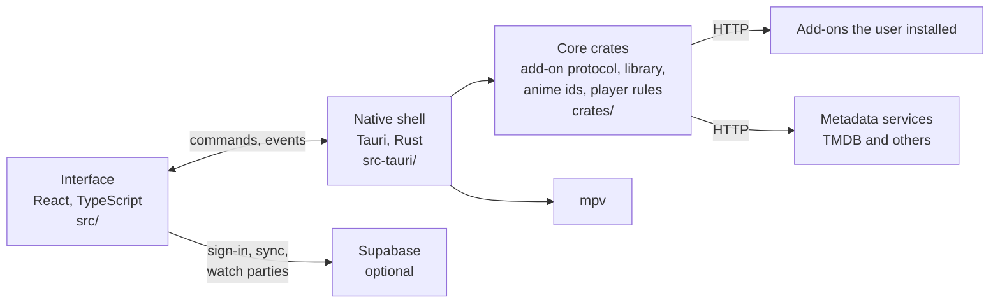

<p align="center">
  <picture>
    <source media="(prefers-color-scheme: dark)" srcset="assets/brand/polarity-colored.svg">
    <source media="(prefers-color-scheme: light)" srcset="assets/brand/polarity-black.svg">
    
  </picture>
</p>

<p align="center">
  A player and library for shows, movies and anime, for Windows, macOS and Linux.<br>
  It plays streams from add-ons you install that use the Stremio add-on protocol; it isn't made or endorsed by Stremio.
</p>

<p align="center">
  <a href="https://ko-fi.com/polarityapp"></a>
</p>

<p align="center">
  <a href="https://github.com/unzoid/polarity/actions/workflows/ci.yml"></a>
  <a href="https://github.com/unzoid/polarity/releases/latest"></a>
  <a href="https://github.com/unzoid/polarity/releases"></a>
  
  <a href="LICENSE"></a>
</p>

<p align="center">
  
  <br>
  <sub>Pictures from the Blender Foundation's open movies, under <a href="https://creativecommons.org/licenses/by/3.0/">CC BY 3.0</a>:
  <i>Sintel</i>, © copyright Blender Foundation | durian.blender.org;
  <i>Tears of Steel</i>, (CC) Blender Foundation | mango.blender.org;
  <i>Big Buck Bunny</i>, (c) copyright 2008, Blender Foundation / www.bigbuckbunny.org.
  Every other title on screen is made up.</sub>
</p>

Polarity is a player for media you're entitled to watch. It doesn't host, provide, index or recommend
content, and it comes with nothing to play from: you choose the add-ons you install.

**Contents:** [Download](#download) · [What's in it](#whats-in-it) · [Getting started](#getting-started) ·
[Your data](#your-data) · [FAQ](#faq) · [Building from source](#building-from-source) · [Contributing](#contributing) ·
[Licence](#licence) · [Donate](#donate) · [Data sources](#data-sources)

## Download

Installers are on the [releases page](https://github.com/unzoid/polarity/releases/latest). On Windows and macOS,
and on Linux as an AppImage, the app updates itself when a new version is out.

| Platform | File | Needs |
|---|---|---|
| Windows | `Polarity-<version>-Windows-x64-setup.exe`, or the `.msi` | Windows 10 or 11, 64-bit. The installer adds Microsoft's WebView2 if it's missing. |
| macOS | `Polarity-<version>-macOS-arm64.dmg` | macOS 11 or later on Apple Silicon |
| Linux | `Polarity-<version>-Linux-x64.AppImage`, `.deb` or `.rpm` | 64-bit, with glibc as new as Ubuntu 22.04's. The `.deb` and `.rpm` install mpv with it. |
| Android (preview) | `Polarity-<version>-Android-arm64-debug.apk` | A debug build for 64-bit phones; doesn't update itself yet |
| iOS (preview) | `Polarity-<version>-iOS-arm64-unsigned.ipa` | Unsigned: installs only once you sign it yourself |

> [!NOTE]
> Not every release carries every platform yet: the releases page lists what each one has. The Windows
> installer isn't code-signed yet, so SmartScreen may warn before it runs. The macOS app isn't notarized:
> if macOS won't open it, choose **Open Anyway** in System Settings → Privacy & Security.

## What's in it

<table>
  <tr>
    <td width="50%" valign="top">
      
      <h3>Browse</h3>
      <ul>
        <li>Home with a featured hero, Continue Watching and trending rows</li>
        <li>Series and Movies pages, and browsing by genre</li>
        <li>An Anime section with its own search, details and episode lists</li>
        <li>Search with recent searches</li>
        <li>IMDb ratings on cards and title pages, and trailers on the title backdrop</li>
        <li>A calendar built from the shows in your library and the ones you're watching</li>
        <li>Notifications when a show you follow has a new episode or season, or a download finishes (off until you turn them on)</li>
      </ul>
    </td>
    <td width="50%" valign="top">
      
      <h3>Watch</h3>
      <ul>
        <li>Plays most files with mpv, inside the app window (Windows, macOS)</li>
        <li>Source, subtitles, audio and speed from the player bar</li>
        <li>Episodes in the player, and a Next Episode button</li>
        <li>Skip intros and recaps, and skip filler episodes in anime</li>
        <li>Subtitle, sound and picture settings that apply straight away, even mid-video</li>
        <li>Black bars inside the picture cropped away with mpv, if you turn it on</li>
        <li>Source filters, a check of each stream before it plays, and what each source carries</li>
        <li>Video files on your computer, with the rest of their folder as episodes</li>
        <li>Resume where you left off, and AirPlay on macOS</li>
      </ul>
    </td>
  </tr>
  <tr>
    <td width="50%" valign="top">
      
      <h3>Library</h3>
      <ul>
        <li>Watchlist, history and your own playlists</li>
        <li>Downloads to watch later, a single episode or a whole season</li>
        <li>A right-click menu on any card for quick actions</li>
      </ul>
    </td>
    <td width="50%" valign="top">
      
      <h3>Together</h3>
      <ul>
        <li>Optional accounts and profiles with their own avatars, synced between your devices</li>
        <li>Watch parties that keep everyone's player in step, with a code to join and host controls</li>
        <li>Show on Discord that you're watching (the default, desktop), what you're watching, or nothing, with a button to watch the same title, and Discord's own Join for your watch party</li>
        <li>TV mode for the couch, with a controller or the arrow keys</li>
      </ul>
    </td>
  </tr>
</table>

<sub>The four pictures above show made-up titles with drawn placeholder art.</sub>

<details>
<summary><b>TV mode and controllers</b></summary>

TV mode has big cards, a clock, and everything reachable with a controller, a remote or the arrow keys. Switch to it
and back with <kbd>F10</kbd>, or in Settings → Controls & TV. Controllers drive the same actions as the keyboard,
so a rebound shortcut moves the controller button with it.


<sub>Pictures from the Blender Foundation's open movies, under <a href="https://creativecommons.org/licenses/by/3.0/">CC BY 3.0</a>:
<i>Sintel</i>, © copyright Blender Foundation | durian.blender.org;
<i>Tears of Steel</i>, (CC) Blender Foundation | mango.blender.org;
<i>Big Buck Bunny</i>, (c) copyright 2008, Blender Foundation / www.bigbuckbunny.org.
Every other title on screen is made up.</sub>

</details>

<details>
<summary><b>Keyboard shortcuts</b></summary>

Every shortcut can be changed, or given a second key, in Settings → Controls & TV. <kbd>Ctrl</kbd> is <kbd>⌘</kbd> on a Mac.

| While watching | Keys |
|---|---|
| Play / pause | <kbd>Space</kbd>, <kbd>K</kbd> |
| Skip back / forward | <kbd>←</kbd> <kbd>→</kbd>, <kbd>J</kbd> <kbd>L</kbd> |
| Volume up / down | <kbd>↑</kbd> <kbd>↓</kbd> |
| Mute | <kbd>M</kbd> |
| Fullscreen | <kbd>F</kbd> |
| Skip intro / recap | <kbd>S</kbd> |
| Next episode | <kbd>N</kbd> |
| Subtitles & audio | <kbd>C</kbd> |
| Episodes | <kbd>E</kbd> |
| Sources | <kbd>O</kbd> |
| Playback speed | <kbd>R</kbd> |

| Anywhere | Keys |
|---|---|
| Search (while browsing) | <kbd>/</kbd>, <kbd>Ctrl</kbd>+<kbd>K</kbd> |
| Open a file | <kbd>Ctrl</kbd>+<kbd>O</kbd> |
| Switch TV / desktop mode | <kbd>F10</kbd> |

</details>

<details>
<summary><b>Torrent streams from your own add-ons</b></summary>

> [!IMPORTANT]
> When one of your own add-ons returns a torrent stream, the desktop and Android apps play it with a built-in engine, after a
> one-time notice of what that does: while it plays, Polarity downloads the file from other people who share it
> and uploads the parts it has to them, and they can see your IP address. You're responsible for what you play.

For torrents from your add-ons, Settings → Sources → Torrent Sources has a cache limit, an upload limit (on by default) and an optional download
limit. Nothing is shared after playback unless you turn that on.

On Android, torrent streams from your add-ons wait for Wi-Fi unless "Play torrent streams on mobile data" is on,
the engine stops when Polarity has been in the background for half a minute, and nothing is shared after playback
while battery saver is on. iPhone and iPad don't play them.

</details>

## Getting started

1. Open Settings → Add-ons and add the URL of an add-on you use (one that follows the Stremio add-on protocol).
2. Optionally add a free TMDB API key in Settings → Services, for logos, sharper posters and episode details.

> [!TIP]
> You don't need an account. Polarity works fully signed out, an account only adds sync between your devices,
> profiles and watch parties.

## Your data

> [!IMPORTANT]
> Signed in, your API keys and add-on URLs sync between your devices and are stored readable on the server,
> protected by your sign-in. Set a passphrase in Settings → Account → API keys and addons and they travel
> encrypted instead; each device asks for the passphrase once.

<details>
<summary><b>Where settings, keys and the library are kept</b></summary>

Settings, the library and history are kept in `polarity.json` in the app's data folder (called `polar.json` in
earlier versions; the first start renames it and keeps the old one as `polar.json.moved`). API keys, add-on
URLs and your sign-in session are kept in the system's keychain (Keychain on macOS, Credential Manager on
Windows, the Secret Service such as GNOME Keyring or KWallet on Linux), under `app.getpolar.desktop`.
Where there is none (phones for now, a Linux desktop without a Secret Service) they stay in `polarity.json`:
on Linux and macOS only your user account can read it, and Windows keeps app data per user, but it isn't
encrypted, so other programs running as you can read your keys. Settings → Account → API keys and addons
says which applies on your device.

What the project's own services keep, and why: [PRIVACY.md](PRIVACY.md). The terms of using them: [TERMS.md](TERMS.md).

</details>

<details>
<summary><b>Logs</b></summary>

When something goes wrong, `polar.log` says what: `%LOCALAPPDATA%\app.getpolar.desktop\logs` on Windows,
`~/Library/Logs/app.getpolar.desktop` on macOS, `~/.local/share/app.getpolar.desktop/logs` on Linux. It
names hosts and reasons, never keys, links or what you watch, and stays under about 2 MB.

</details>

## FAQ

<details>
<summary><b>Does Polarity come with anything to watch?</b></summary>

No. It ships with no add-ons and suggests none. It plays what the add-ons you install return, and files on your
own computer.

</details>

<details>
<summary><b>Which add-ons work with it?</b></summary>

Add-ons that follow the Stremio add-on protocol: you add one by its URL in Settings → Add-ons. The project doesn't
list, recommend or check any of them.

</details>

<details>
<summary><b>Does it cost anything?</b></summary>

No. Polarity is MIT-licensed, every feature is in the free app, and donations unlock nothing.

</details>

<details>
<summary><b>Why does a video play differently on Linux?</b></summary>

On Windows and macOS, mpv plays inside the app window. On Linux, mpv can't draw into the app's window yet, so
videos play in the system web view (WebKitGTK), and which formats play depends on the GStreamer plugins installed.

</details>

<details>
<summary><b>Something doesn't work. Where do I report it?</b></summary>

[Open an issue](https://github.com/unzoid/polarity/issues/new/choose) with the form that fits (bug, playback,
title data, performance, look and feel, accessibility, documentation, feature). The log above helps. Security
problems go privately, as [SECURITY.md](SECURITY.md) says, never in a public issue.

</details>

## Building from source

You'll need [Rust](https://rustup.rs) and [Bun](https://bun.sh), and for your platform:

- **Windows:** the MSVC C++ Build Tools. `bun run app` fetches the mpv build the app bundles: CI's copy through the
  GitHub CLI (`gh`, signed in), or else the one the newest release attaches.
- **macOS:** Xcode's command line tools, and libmpv (`brew install mpv`).
- **Linux:** the WebKitGTK and Tauri build packages, on Debian or Ubuntu
  `libwebkit2gtk-4.1-dev libsoup-3.0-dev libayatana-appindicator3-dev librsvg2-dev libxdo-dev libssl-dev libudev-dev`.

```sh
bun install
bun run app
```

Notifications (Settings → Notifications) show only from an installed or bundled build: on macOS the `.app`
(`bunx tauri build --debug --bundles app`), not the bare binary `bun run app` starts; on Windows the installed app,
whose Start menu shortcut carries the app's id.

Accounts and watch parties need a Supabase project: copy `.env.example` to `.env` and fill it in
([docs/supabase-storage.md](docs/supabase-storage.md)). Leave it out and the app runs without accounts.

To run the optional catalog add-on locally:

```sh
bun run index
```

## Contributing



How the code is put together, and where each feature above lives: [docs/ARCHITECTURE.md](docs/ARCHITECTURE.md).
The interface's components and conventions: [docs/ui-components.md](docs/ui-components.md). What could only be
read, not run, before release, and how to check it: [docs/unverified.md](docs/unverified.md). Checks to run before
a pull request: `bun run typecheck`, `bun run test`, and `cargo test --workspace`; CI runs these and the Playwright
tests (`bun run e2e`) on every push, and a smoke test of the built app nightly. How to run and add each kind of test:
[docs/testing.md](docs/testing.md).

To take an issue, comment `/assign` on it (no access to the repository needed); `/unassign` gives it back.
What the project won't accept, and the rules coding agents follow: [CONTRIBUTING.md](CONTRIBUTING.md),
[AGENTS.md](AGENTS.md). Security research and reports: [SECURITY.md](SECURITY.md).

Screenshots and recordings for the README use openly licensed films or made-up titles only:
[docs/screenshots.md](docs/screenshots.md) explains how to play a film in Polarity, how to credit it, and how
`scripts/readme-shots.ts` makes the pictures above.

## Licence

MIT, see [LICENSE](LICENSE). Bundled fonts, avatars and mpv keep their own licences: [docs/licensing.md](docs/licensing.md).

## Donate

[Donate on Ko-fi](https://ko-fi.com/polarityapp). One-off donations only, to the project's owner: no tiers, no perks, and nothing in the app depends on
them. They pay for running costs: the Supabase plan behind accounts and sync, Apple's developer
programme for an iOS release, and a Windows code-signing certificate.

## Data sources

<a href="https://www.themoviedb.org/"></a>
This product uses the TMDB API but is not endorsed or certified by TMDB.

Titles, artwork and other metadata shown in the app come from third-party services and belong to their
owners. Which services, and on what terms: [docs/data-sources.md](docs/data-sources.md).

## Built with

[Tauri](https://tauri.app) and Rust for the app shell, React and TypeScript for the interface, and [mpv](https://mpv.io) for playback.
